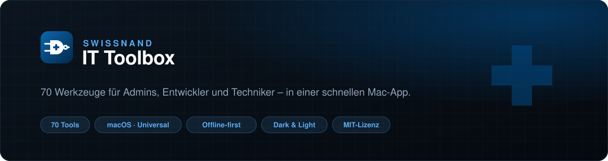
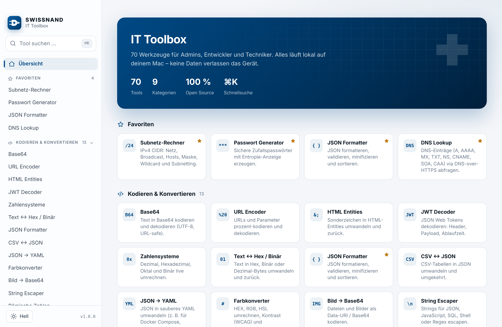
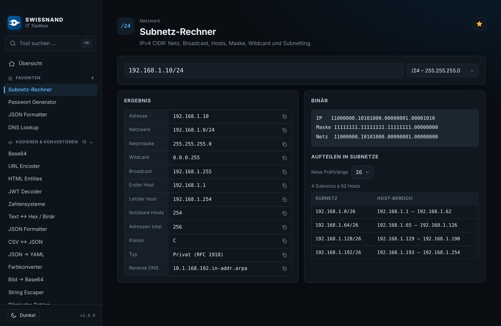
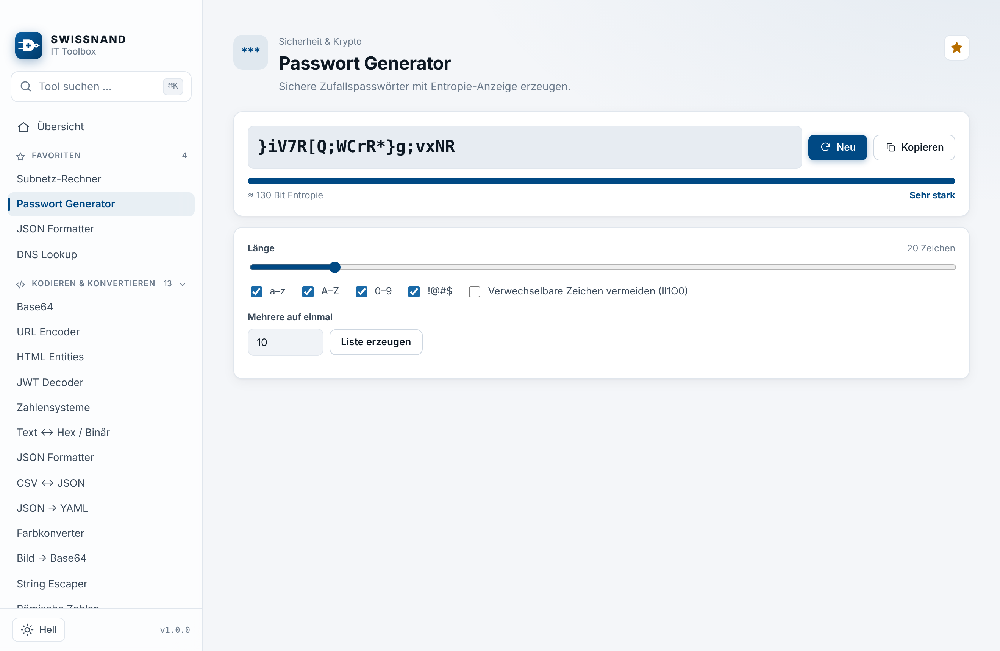
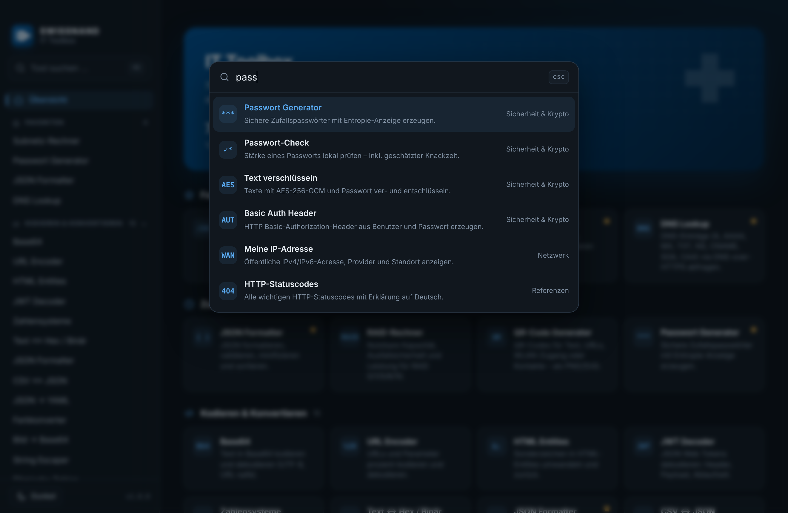
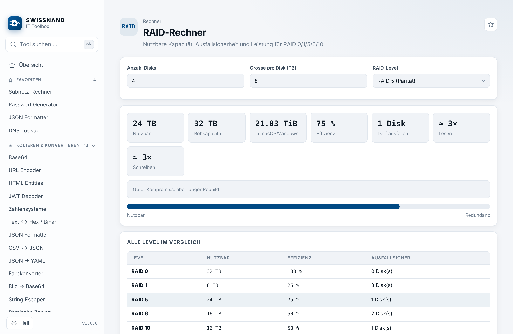
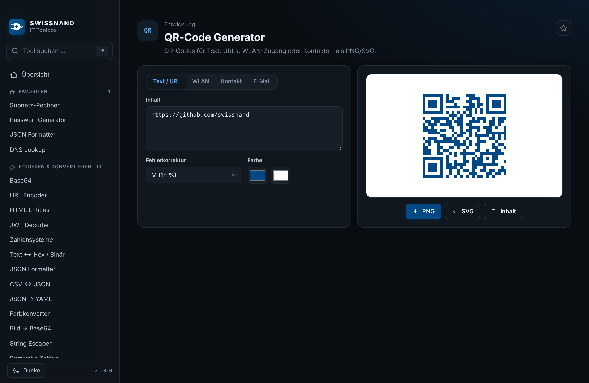
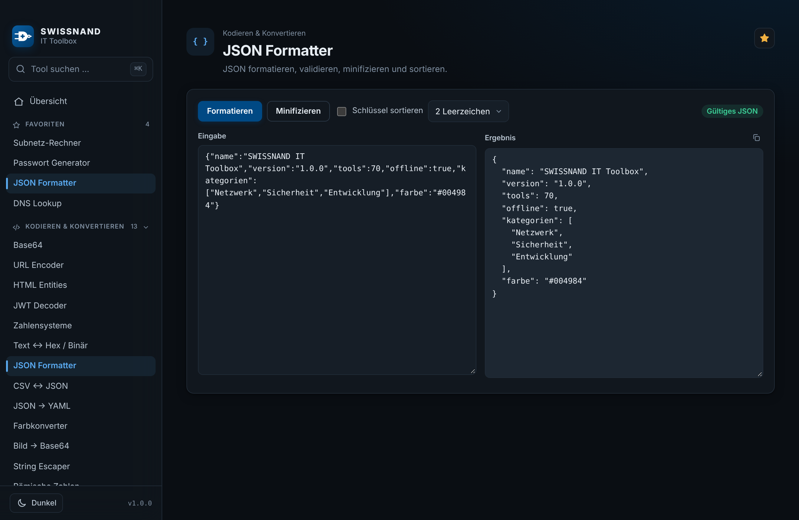

<div align="center">

<picture>
  <source media="(prefers-color-scheme: dark)" srcset="assets/banner-dark.svg">
  <source media="(prefers-color-scheme: light)" srcset="assets/banner-light.svg">
  
</picture>

<br><br>

[](https://github.com/swissnand/it-toolbox/releases/latest)
[](https://swissnand.github.io/it-toolbox/)


**70 Werkzeuge für Admins, Entwickler und Techniker – in einer schnellen, schönen Mac-App.**
<br>Subnetze rechnen, Hashes prüfen, JWTs lesen, Passwörter erzeugen, Cron verstehen, DNS abfragen … ohne zehn Browser-Tabs.

</div>

---

## ✦ Highlights

<table>
<tr>
<td width="33%" valign="top">

### 🔒 Privat
Alles läuft **lokal auf deinem Mac**. Keine Cloud, kein Tracking, keine Accounts. Nur DNS-Lookup und „Meine IP“ gehen bewusst ins Internet.

</td>
<td width="33%" valign="top">

### ⚡ Schnell
**⌘K** öffnet die Schnellsuche – Tool tippen, Enter, fertig. Favoriten und „Zuletzt verwendet“ merken sich, was du brauchst.

</td>
<td width="33%" valign="top">

### 🎨 SWISSNAND Design
Modernes IT-Design in **Dark & Light Mode** (folgt automatisch macOS), Akzentfarbe <code>#004984</code>, native Mac-Titelleiste.

</td>
</tr>
</table>

## 📸 Screenshots

<picture>
  <source media="(prefers-color-scheme: dark)" srcset="assets/screenshots/home-dark.png">
  
</picture>

<table>
<tr>
<td><p align="center"><sub>Subnetz-Rechner mit Subnetting</sub></p></td>
<td><p align="center"><sub>Passwort-Generator mit Entropie</sub></p></td>
</tr>
<tr>
<td><p align="center"><sub>Schnellsuche mit ⌘K</sub></p></td>
<td><p align="center"><sub>RAID-Rechner</sub></p></td>
</tr>
<tr>
<td><p align="center"><sub>QR-Codes inkl. WLAN-Zugang</sub></p></td>
<td><p align="center"><sub>JSON-Formatter</sub></p></td>
</tr>
</table>

## 📥 Installation

1. Neueste **`.dmg`** bei den [Releases](https://github.com/swissnand/it-toolbox/releases/latest) herunterladen (Universal – läuft auf Apple Silicon und Intel).
2. DMG öffnen und **SWISSNAND IT Toolbox** in den Ordner **Programme** ziehen.
3. Beim ersten Start: **Rechtsklick auf die App → Öffnen → Öffnen**.

> [!NOTE]
> Die App ist Open Source, aber (noch) nicht von Apple notarisiert. Darum fragt macOS beim ersten Start nach. Falls „App ist beschädigt“ erscheint, hilft im Terminal:
> ```bash
> xattr -cr "/Applications/SWISSNAND IT Toolbox.app"
> ```

**Ohne Installation:** Die gleiche Toolbox läuft auch direkt im Browser unter **[swissnand.github.io/it-toolbox](https://swissnand.github.io/it-toolbox/)**.

## 🧰 Alle Tools

<details>
<summary><b>Kodieren & Konvertieren</b> · 13 Tools</summary>

| Tool | Beschreibung |
|---|---|
| **Base64** | Text in Base64 kodieren und dekodieren (UTF-8, URL-safe). |
| **URL Encoder** | URLs und Parameter prozent-kodieren und dekodieren. |
| **HTML Entities** | Sonderzeichen in HTML-Entities umwandeln und zurück. |
| **JWT Decoder** | JSON Web Tokens dekodieren: Header, Payload, Ablaufzeit. |
| **Zahlensysteme** | Dezimal, Hexadezimal, Oktal und Binär live umrechnen. |
| **Text ↔ Hex / Binär** | Text in Hex, Binär oder Dezimal-Bytes umwandeln und zurück. |
| **JSON Formatter** | JSON formatieren, validieren, minifizieren und sortieren. |
| **CSV ↔ JSON** | CSV-Tabellen in JSON umwandeln und umgekehrt. |
| **JSON → YAML** | JSON in sauberes YAML umwandeln (z. B. für Docker Compose, Kubernetes). |
| **Farbkonverter** | HEX, RGB, HSL umrechnen, Kontrast (WCAG) und Farbabstufungen. |
| **Bild → Base64** | Dateien und Bilder als Data-URI / Base64 kodieren. |
| **String Escaper** | Strings für JSON, JavaScript, SQL, Shell oder Regex escapen. |
| **Römische Zahlen** | Arabische Zahlen in römische umwandeln und zurück. |

</details>

<details open>
<summary><b>Sicherheit & Krypto</b> · 9 Tools</summary>

| Tool | Beschreibung |
|---|---|
| **Hash Generator** | MD5, SHA-1, SHA-256, SHA-384, SHA-512 für Text oder Dateien. |
| **HMAC Generator** | HMAC-Signaturen mit SHA-1/256/384/512 erzeugen (z. B. für Webhooks). |
| **Passwort Generator** | Sichere Zufallspasswörter mit Entropie-Anzeige erzeugen. |
| **Passwort-Check** | Stärke eines Passworts lokal prüfen – inkl. geschätzter Knackzeit. |
| **UUID Generator** | UUID v4 (zufällig) und v7 (zeitbasiert) einzeln oder in Mengen. |
| **Token Generator** | Zufällige API-Keys, Secrets und Tokens (Hex, Base64url, Alphanumerisch). |
| **Text verschlüsseln** | Texte mit AES-256-GCM und Passwort ver- und entschlüsseln. |
| **Basic Auth Header** | HTTP Basic-Authorization-Header aus Benutzer und Passwort erzeugen. |
| **2FA / TOTP Codes** | Einmal-Codes (Google Authenticator kompatibel) aus einem Secret berechnen. |

</details>

<details open>
<summary><b>Netzwerk</b> · 9 Tools</summary>

| Tool | Beschreibung |
|---|---|
| **Subnetz-Rechner** | IPv4 CIDR: Netz, Broadcast, Hosts, Maske, Wildcard und Subnetting. |
| **IP-Konverter** | IPv4 zwischen Punkt-, Dezimal-, Hex- und Binärdarstellung umrechnen. |
| **IPv6-Werkzeug** | IPv6-Adressen expandieren, komprimieren und Präfixe berechnen. |
| **MAC-Adressen** | MAC-Adressen formatieren, analysieren und zufällig generieren. |
| **URL-Analyse** | URLs in Bestandteile zerlegen und Query-Parameter bearbeiten. |
| **DNS Lookup** | DNS-Einträge (A, AAAA, MX, TXT, NS, CNAME, SOA, CAA) via DNS-over-HTTPS abfragen. |
| **Meine IP-Adresse** | Öffentliche IPv4/IPv6-Adresse, Provider und Standort anzeigen. |
| **User-Agent Parser** | User-Agent-Strings analysieren: Browser, Engine, Betriebssystem, Gerät. |
| **Wake-on-LAN Paket** | Magic Packet für Wake-on-LAN erzeugen inkl. Terminal-Befehle. |

</details>

<details>
<summary><b>Text</b> · 9 Tools</summary>

| Tool | Beschreibung |
|---|---|
| **Text-Statistik** | Zeichen, Wörter, Zeilen, Bytes, Lesezeit und häufigste Wörter zählen. |
| **Case Converter** | camelCase, snake_case, kebab-case, PascalCase, UPPER und mehr. |
| **Text-Vergleich (Diff)** | Zwei Texte oder Konfigurationen zeilenweise vergleichen. |
| **Regex-Tester** | Reguläre Ausdrücke live testen, Gruppen anzeigen, Suchen & Ersetzen. |
| **Lorem Ipsum** | Blindtext als Absätze, Sätze oder Wörter erzeugen. |
| **Zeilen-Werkzeug** | Zeilen sortieren, Duplikate entfernen, umkehren, mischen, nummerieren. |
| **Slug Generator** | URL-freundliche Slugs und Dateinamen erzeugen (inkl. Umlaute). |
| **Markdown Vorschau** | Markdown live als HTML anzeigen und exportieren. |
| **Zeichen-Inspektor** | Unicode-Codepoints, UTF-8/UTF-16-Bytes und unsichtbare Zeichen anzeigen. |

</details>

<details>
<summary><b>Entwicklung</b> · 7 Tools</summary>

| Tool | Beschreibung |
|---|---|
| **Cron-Ausdrücke** | Cron-Jobs erklären lassen und die nächsten Ausführungen berechnen. |
| **chmod-Rechner** | Unix-Dateirechte zwischen Oktal, Symbolik und Checkboxen umrechnen. |
| **QR-Code Generator** | QR-Codes für Text, URLs, WLAN-Zugang oder Kontakte – als PNG/SVG. |
| **SQL Formatter** | SQL-Abfragen lesbar formatieren oder auf eine Zeile minifizieren. |
| **.gitignore Generator** | .gitignore-Dateien aus Vorlagen für Systeme, Sprachen und Tools bauen. |
| **curl Builder** | HTTP-Requests zusammenklicken und als curl, fetch oder Python-Code exportieren. |
| **docker run → Compose** | docker run-Befehle in eine docker-compose.yml umwandeln. |

</details>

<details>
<summary><b>Zeit & Datum</b> · 5 Tools</summary>

| Tool | Beschreibung |
|---|---|
| **Unix Timestamp** | Unix-Zeit (Sekunden/Millisekunden) in Datum umrechnen und zurück. |
| **Weltzeituhr** | Uhrzeiten weltweit vergleichen und Meeting-Zeiten umrechnen. |
| **Datumsrechner** | Differenz zwischen Daten, Arbeitstage und Tage addieren/subtrahieren. |
| **Kalenderwochen** | ISO-Kalenderwochen eines Jahres mit Datumsbereich anzeigen. |
| **Stoppuhr & Timer** | Stoppuhr mit Runden und Countdown-Timer mit Ton. |

</details>

<details>
<summary><b>Rechner</b> · 8 Tools</summary>

| Tool | Beschreibung |
|---|---|
| **Datengrössen** | Bytes, KB, MB, GB, TB (dezimal) und KiB, MiB, GiB (binär) umrechnen. |
| **Übertragungszeit** | Wie lange dauert ein Download/Backup bei gegebener Bandbreite? |
| **RAID-Rechner** | Nutzbare Kapazität, Ausfallsicherheit und Leistung für RAID 0/1/5/6/10. |
| **MwSt-Rechner (CH)** | Schweizer Mehrwertsteuer: Netto ↔ Brutto mit 8,1 %, 2,6 % oder 3,8 %. |
| **IBAN-Prüfer** | IBAN validieren (Prüfziffer, Länge) und formatieren – inkl. QR-IBAN. |
| **Seitenverhältnis** | Seitenverhältnisse berechnen und Auflösungen proportional skalieren. |
| **Stromkosten-Rechner** | Was kostet ein Server, NAS oder Rack im Dauerbetrieb pro Jahr? |
| **Prozentrechner** | Prozentwerte, Anteile und Veränderungen schnell berechnen. |

</details>

<details>
<summary><b>Referenzen</b> · 7 Tools</summary>

| Tool | Beschreibung |
|---|---|
| **HTTP-Statuscodes** | Alle wichtigen HTTP-Statuscodes mit Erklärung auf Deutsch. |
| **Port-Liste** | Häufige TCP/UDP-Ports und ihre Dienste – für Firewall & Troubleshooting. |
| **Git Spickzettel** | Die wichtigsten Git-Befehle für Alltag, Branches und Notfälle. |
| **macOS Befehle** | Terminal-Befehle und Tastenkürzel für Mac-Admins. |
| **Linux Befehle** | Wichtige Linux-Befehle für Server, Netzwerk, Dienste und Docker. |
| **ASCII-Tabelle** | Alle 128 ASCII-Zeichen mit Dezimal, Hex, Oktal, Binär und HTML. |
| **MIME-Typen** | Dateiendungen und ihre Content-Types für Webserver und APIs. |

</details>

<details>
<summary><b>System</b> · 3 Tools</summary>

| Tool | Beschreibung |
|---|---|
| **System-Info** | Bildschirm, CPU-Kerne, Speicher, GPU, Sprache und Netzwerkstatus. |
| **Tastatur-Tester** | Tastendruck anzeigen: key, code, keyCode und Modifier – ideal zum Testen. |
| **Bildschirm-Test** | Pixelfehler, Ausleuchtung und Farbverläufe am Display prüfen (Vollbild). |

</details>

## ⌨️ Tastenkürzel

| Kürzel | Aktion |
|---|---|
| <kbd>⌘</kbd> <kbd>K</kbd> | Schnellsuche öffnen |
| <kbd>↑</kbd> <kbd>↓</kbd> <kbd>↵</kbd> | In der Suche navigieren und öffnen |
| <kbd>⌘</kbd> <kbd>0</kbd> | Zur Übersicht |
| <kbd>⌘</kbd> <kbd>+</kbd> / <kbd>−</kbd> | Zoomen |
| ★ oben rechts | Tool als Favorit markieren |

## 🛠 Selbst bauen

Voraussetzung: [Node.js](https://nodejs.org) 20 oder neuer.

```bash
git clone https://github.com/swissnand/it-toolbox.git
cd it-toolbox
npm install
npm start            # App im Entwicklungsmodus starten
npm run dist         # DMG bauen → liegt danach in dist/
```

Die Web-Version ohne Electron: `npm run web` und dann <http://localhost:8080> öffnen.

### Automatische Releases

Ein neuer Versions-Tag baut die DMG automatisch auf einem macOS-Server von GitHub und hängt sie an ein Release:

```bash
git tag v1.0.0
git push origin v1.0.0
```

## 🧩 Eigenes Tool hinzufügen

Jedes Tool ist ein kleines Objekt in `src/js/tools/<kategorie>.js`:

```js
TB.register({
  id: 'mein-tool',
  name: 'Mein Tool',
  glyph: 'MT',                 // Kürzel im Icon
  cat: 'dev',                  // encode | security | network | text | dev | time | calc | reference | system
  desc: 'Was das Tool macht.',
  keywords: 'suchbegriffe für ⌘K',
  render(root, U) {
    root.innerHTML = `<div class="panel"><input id="in"><div id="out" class="out"></div></div>`;
    U.q('#in').oninput = (e) => { U.q('#out').textContent = e.target.value.toUpperCase(); };
  },
});
```

`U` liefert Helfer wie `copy()`, `kv()`, `download()`, `esc()`, `store` und `randInt()`. Kein Framework, kein Build-Schritt – nur HTML, CSS und JavaScript.

## 📁 Projektstruktur

```
it-toolbox/
├── main.js              Electron-Hauptprozess (Fenster, Menü)
├── preload.js           Sichere Brücke (ohne Node-Zugriff)
├── src/
│   ├── index.html       App-Shell
│   ├── css/style.css    SWISSNAND Design-System (Dark/Light)
│   ├── js/core.js       Registry, Kategorien, Helfer
│   ├── js/app.js        Navigation, Suche, Favoriten, Design
│   ├── js/tools/        Alle Tools nach Kategorie
│   └── vendor/          qrcode-generator, marked (MIT)
├── build/               App-Icon und DMG-Hintergrund
└── .github/workflows/   DMG-Build und GitHub Pages
```

## 🔐 Sicherheit

- `contextIsolation`, `sandbox` und keine Node-Integration im Renderer
- Strikte Content-Security-Policy; Netzwerk nur zu Cloudflare-DNS und ipify/ipapi
- Krypto über die WebCrypto-API (AES-256-GCM, PBKDF2, SHA-2, HMAC)
- Zufall ausschliesslich aus `crypto.getRandomValues()` ohne Modulo-Bias

## 🤝 Mitmachen

Ideen für neue Tools, Fehler oder Verbesserungen? Gerne als [Issue](https://github.com/swissnand/it-toolbox/issues) oder Pull Request.

---

<div align="center">
<sub>Gebaut mit ♥ in der Schweiz von <a href="https://github.com/swissnand"><b>SWISSNAND</b></a> · MIT-Lizenz</sub>
</div>
